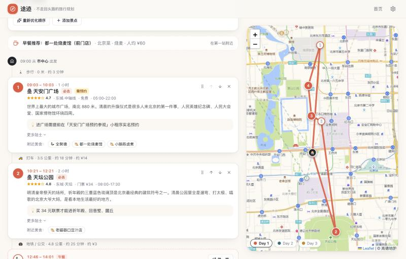

<h1 align="center">途迹 · Tuji</h1>

<p align="center"><strong>不走回头路的城市旅行规划 · A route-optimized city trip planner</strong></p>

<p align="center">
  <a href="https://kaikungao.github.io/tuji-travel-planner/"></a>
  <a href="https://github.com/KaikunGao/tuji-travel-planner/actions/workflows/deploy.yml"></a>
  <a href="LICENSE"></a>
  
  
  
</p>

<p align="center">
  <a href="#中文">中文</a> · <a href="#english">English</a>
</p>

<p align="center">
  <a href="https://kaikungao.github.io/tuji-travel-planner/"></a>
  <a href="https://kaikungao.github.io/tuji-travel-planner/"></a>
</p>

---

## 中文

**在线使用：https://kaikungao.github.io/tuji-travel-planner/** （无需注册，行程保存在你自己的浏览器里）

输入一座城市，途迹会按地理位置把景点聚成每一天，再用精确最短路径算法排出游览顺序（夜景压轴、上午景点在前），沿途自动安排午餐晚餐，并附上综合整理的美食评价、预算估算、预约清单与避雷提示。没有内置数据的城市，可以让 Claude 现场生成。

### 功能

- **智能路线**：k-means 按位置分天 → 簇间平衡（必去优先）→ Held-Karp 精确求最短开放路径 + 时段偏好惩罚 → 按开放时间排程；闭馆日自动避开，接近闭园会提醒并尝试调整顺序
- **远郊一日游**：长城、三星堆这类离市区 20 公里以上的景点单独成天（2 天以上行程可开启）
- **美食推荐**：午餐 / 晚餐 /（选了「美食探店」时的）下午茶就近挑选，考虑顺路程度、评分、价格与菜系多样性；每家餐厅附「综合评价」（一句话总评 + 大家喜欢 / 注意与吐槽 + 适合场景）、必点菜、排队提示和避雷，并可一键跳转小红书搜索真实笔记
- **可调整**：拖拽或上移 / 下移景点，移除 / 添加景点，一键换餐厅，重新优化顺序，所有时间自动重算
- **偏好**：出行方式（均衡 / 多步行 / 公共交通 / 打车优先）、饮食偏好（不吃辣 / 素食 / 清真 / 忌口 / 人均上限）、出发点（搜索酒店地址或在地图上点选）
- **多方案对比**：推荐 / 省时省力 / 省钱 / 打卡多，并排比较后一键切换
- **地图**：Leaflet 地图按天着色显示路线与编号站点；默认高德底图（已做 WGS-84 → GCJ-02 转换），可切换 OpenStreetMap / Esri
- **预算**：门票、餐饮、市内交通按人估算，可设人数与住宿
- **贴士**：最佳季节、预约清单、交通、避雷、自动生成的打包清单
- **保存 / 导出 / 分享**：行程保存在本机浏览器；复制 / 下载 Markdown、打印、导出 .ics 日历；生成分享链接和二维码，打开即还原
- **AI 生成任意城市**：线上版本访客直接可用（请求经由 `worker/` 里的 Cloudflare Worker 代理，站长的 Key 只存在 Cloudflare 机密里，每人每天 3 次、全站每天 40 次）；也可在设置里填自己的 Anthropic API Key 不受限制。Claude 分两步生成景点与美食数据（结构化输出 + 流式进度）

### 内置城市

北京、上海、成都、重庆、西安、杭州、长沙、广州、厦门（共 9 座，198 个景点、172 家餐厅，全部通过数据校验）。

### 工作原理

```
城市数据 ──► 打分（评分 / 必去 / 兴趣 / 方案偏好）
         ──► 候选池（兼顾地理紧凑度）
         ──► k-means 分天（最远点初始化）
         ──► 簇间平衡（必去优先、时间预算、就近移动）
         ──► Held-Karp 精确最短开放路径 + 时段惩罚（夜景压轴、上午优先）
         ──► 按开放时间排程，插入午餐 / 晚餐 / 下午茶，闭园修复
         ──► 远郊景点单独成天 ──► 预算 / 贴士 / 打包清单
```

核心全部在浏览器本地计算，没有后端；只有「AI 生成城市」会请求 Claude（经代理或你自己的 Key）。

### 本地运行

```bash
npm install
npm run dev        # http://localhost:5173
```

其他命令：

```bash
npm run typecheck                                        # TypeScript 检查
npm run build                                            # 生产构建到 dist/
npm run validate -- src/data/cities/beijing.ts           # 校验某个城市数据
npx tsx scripts/try-plan.ts src/data/cities/beijing.ts 3 moderate 历史文化,美食探店 2026-11-02   # 命令行试跑规划
```

### 部署

**网站（GitHub Pages）**：仓库自带 `.github/workflows/deploy.yml`，推送到 `main` 后自动构建并发布到 `https://<用户名>.github.io/<仓库名>/`。Fork 后只需在仓库 Settings → Pages 把 Source 设为 **GitHub Actions**。

**AI 代理（可选，Cloudflare Workers）**：让访客不填 Key 也能用 AI。

1. `cd worker && npm install && npx wrangler login`
2. `npx wrangler kv namespace create QUOTA`，把 id 填进 `worker/wrangler.toml`
3. `npx wrangler secret put ANTHROPIC_API_KEY`（Key 只进 Cloudflare 机密，不进代码）
4. `npx wrangler deploy`，然后把仓库变量 `AI_PROXY_URL` 设为 Worker 地址，重新推送即可

限流、模型白名单、邀请码等见 [worker/README.md](worker/README.md)。

### 添加一座城市

1. 复制 `src/data/cities/beijing.ts` 作为模板，按 `src/types.ts` 里的注释填写（坐标用 WGS-84）
2. `npm run validate -- src/data/cities/<id>.ts` 做到 0 个错误
3. 在 `src/data/index.ts` 的 `BUILTIN_CITIES` 里注册

欢迎通过 Pull Request 贡献城市数据。

### 目录结构

```
src/
  types.ts                 数据类型
  lib/
    planner.ts             规划核心：打分、聚类、平衡、TSP、排程、手动调整
    geo.ts                 距离 / 出行估算 / 坐标转换
    ai.ts                  Claude 生成城市数据
    share.ts ics.ts        分享链接 / 日历导出
    geocode.ts             酒店地址搜索
    export.ts storage.ts format.ts
  data/
    index.ts               城市注册表
    cities/*.ts            城市数据
  components/              页面与组件（Home、CityPage、PlanPage、DayTimeline、MapView、FoodTab…）
worker/                    Cloudflare Worker：AI 请求代理与限流
scripts/
  validate-city.ts         数据校验
  try-plan.ts              命令行试跑
```

### 开发日志

每一步改进、已知问题和拓展功能路线图见 [PROGRESS.md](PROGRESS.md)。

### 说明

- 门票、营业时间、价格为编写时的参考值，出行前请以官方最新信息为准。
- 餐厅的「综合评价」是根据公开评价**综合整理的中立陈述**（不是逐条引用的帖子，不含虚构作者或点赞数），用于说明推荐理由与注意事项；每家店都有「去小红书看真实笔记」链接。
- AI 生成：线上默认经由 Cloudflare Worker 代理；填了自己的 Key 则直接从浏览器请求 Anthropic，Key 只保存在本机 localStorage。

---

## English

**Try it: https://kaikungao.github.io/tuji-travel-planner/** (no sign-up; plans are stored in your own browser)

Tuji (途迹, "the trail of a journey") turns a city name into a day-by-day itinerary that never doubles back. It clusters attractions into days by location, solves the exact shortest open path for each day with time-of-day preferences (sunset spots last, morning spots first), slots lunch and dinner along the way, and adds consolidated food reviews, a budget estimate, booking reminders and pitfalls to avoid. Cities without built-in data can be generated on the spot by Claude.

### Features

- **Route engine**: k-means day clustering → cluster balancing (must-sees first) → Held-Karp exact shortest open path with time-slot penalties → scheduling against opening hours, with closed-day avoidance and closing-time repair
- **Suburb day trips**: far-out attractions (Great Wall, Sanxingdui…) get their own day with travel-time caps
- **Food picks**: lunch / dinner / afternoon tea chosen near the route, weighing detour, rating, price and cuisine variety; every restaurant has a neutral consolidated review (one-line verdict, what people like, what to watch out for, best for), must-order dishes, queue tips and a link to search real posts on Xiaohongshu
- **Editable**: drag-and-drop reorder, add / remove stops, swap restaurants, re-optimize; all times recomputed
- **Preferences**: transport mode (balanced / walk / transit / taxi), dietary needs (no spicy, vegetarian, halal, allergens, price cap), custom start point (hotel address search or map click)
- **Plan comparison**: Recommended / Fast / Budget / Max-sights side by side, switch with one click
- **Map**: Leaflet with per-day colored routes and numbered stops; AMap tiles by default (WGS-84 → GCJ-02 handled), OpenStreetMap / Esri optional
- **Budget & tips**: tickets, meals and transport per person; best season, bookings, packing list
- **Save / export / share**: local storage, Markdown export, print, `.ics` calendar, share links with QR code
- **AI city generation**: visitors can use it without a key through a Cloudflare Worker proxy that holds the owner's key as a secret and rate-limits per IP and per day; or bring your own Anthropic API key. Two-step structured generation with streaming progress

### Built-in cities

Beijing, Shanghai, Chengdu, Chongqing, Xi'an, Hangzhou, Changsha, Guangzhou, Xiamen — 198 attractions and 172 restaurants, all validated.

### How it works

```
city data ──► scoring (rating / must-see / interests / plan variant)
          ──► compact candidate pool
          ──► k-means into days (farthest-first init)
          ──► cluster balancing (must-sees, time budget, nearby moves)
          ──► Held-Karp exact shortest open path + time-slot penalties
          ──► scheduling with opening hours, meal insertion, closing-time repair
          ──► suburb days ──► budget / tips / packing list
```

Everything runs in the browser; there is no backend. Only "generate a city with AI" calls Claude, via the proxy or your own key.

### Quick start

```bash
npm install
npm run dev        # http://localhost:5173
```

```bash
npm run typecheck
npm run build
npm run validate -- src/data/cities/beijing.ts
npx tsx scripts/try-plan.ts src/data/cities/beijing.ts 3 moderate 历史文化,美食探店 2026-11-02
```

### Deploy

- **Site**: push to `main` and the included GitHub Actions workflow builds and publishes to GitHub Pages (set Pages → Source to **GitHub Actions** once after forking).
- **AI proxy (optional)**: `cd worker`, create a KV namespace, `npx wrangler secret put ANTHROPIC_API_KEY`, `npx wrangler deploy`, then set the repository variable `AI_PROXY_URL`. Limits, model allowlist and invite codes are documented in [worker/README.md](worker/README.md).

### Tech stack

Vite 8 · React 19 · TypeScript 7 · Tailwind CSS 4 · Leaflet · dnd-kit · lz-string · Anthropic SDK · Cloudflare Workers

### Contributing

City data lives in `src/data/cities/*.ts`; copy `beijing.ts`, fill it in (WGS-84 coordinates), run `npm run validate` until it reports zero errors, and register it in `src/data/index.ts`. Pull requests are welcome. The full changelog and roadmap are in [PROGRESS.md](PROGRESS.md) (Chinese).

### Notes

Ticket prices and opening hours are reference values at the time of writing. Restaurant reviews are neutral summaries of public opinion, not quoted posts. Your own API key, if you add one, never leaves your browser's local storage.

## License

[MIT](LICENSE) © 2026 KaikunGao
