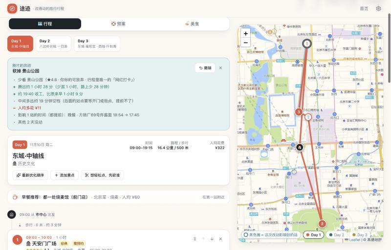
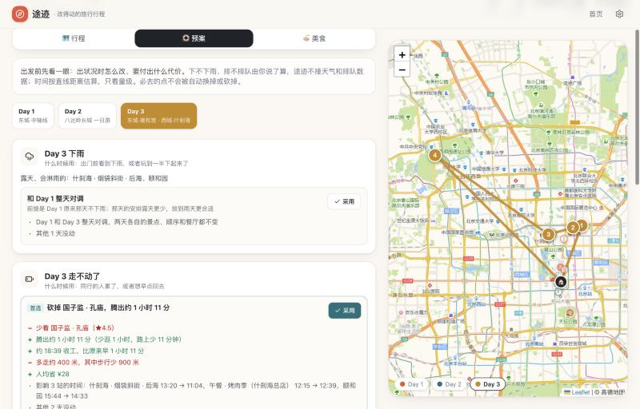

<h1 align="center">途迹 · Tuji</h1>

<p align="center"><strong>改得动的旅行行程 · A trip plan that survives change</strong></p>

<p align="center">
  <a href="https://kaikungao.github.io/tuji-travel-planner/"></a>
  <a href="https://github.com/KaikunGao/tuji-travel-planner/actions/workflows/deploy.yml"></a>
  <a href="LICENSE"></a>
  
  
  
</p>

<p align="center">
  <a href="#中文">中文</a> · <a href="#english">English</a>
</p>

<p align="center">
  <a href="https://kaikungao.github.io/tuji-travel-planner/"></a>
  <a href="https://kaikungao.github.io/tuji-travel-planner/"></a>
  <a href="https://kaikungao.github.io/tuji-travel-planner/"></a>
</p>

---

## 中文

**在线使用：https://kaikungao.github.io/tuji-travel-planner/** （无需注册，行程保存在你自己的浏览器里）

计划赶不上变化，行程改一下就好。

做攻略最大的成本不是排，是排完之后不敢改：下雨了、排队了、有人累了，要么全部重排，要么将就着走。途迹的做法是——先说清哪些点必去、哪些可以放弃，排出行程的同时把预案算好；之后任何变动，只改受影响的那一段，并把代价算给你看。

### 功能

- **三档意愿**：每个景点标必去 / 可选 / 可放弃。必去是硬约束，任何自动方案都不会替换或砍掉它；可放弃的是预备牺牲品，时间不够先砍它；没标的都是可选。
- **改动代价**：砍一个点之前先看代价——少看什么、腾出多久（少逛 + 路上）、几点收工、路程和花费怎么变、后面哪几站的时间跟着动、有没有新的时间冲突。「想轻松点，先砍谁」按档位把候选排好。每次改动之后有回执，可以一键撤销。
- **预案**：出发前就能看到四种状况各自的方案和代价——这天下雨、走不动了、某个点去不了、某个点排队太久。下不下雨、排不排队由你说了算，途迹不接天气和排队数据。必去的点只给换天，不给替代；方案不允许带来新的时间冲突。
- **给约束，不给预测**：排队预案不说「你 13:47 到」，而是说「最晚 14:59 进场，再晚闭园前就逛不完了」，并留出余量。
- **行中模式**：路上走完一站点一下，可以改「现在几点」。走完的站原样保留，之后的改动和预案只重算还没走的那一段；晚点的后果（后面哪几站顺延、有没有冲突）直接列出来。
- **路线与排程**（底层）：k-means 按位置分天 → 簇间平衡 → 每天内求最短开放路径并照顾时段偏好（夜景压轴、上午景点在前）→ 按开放时间排程；填了出发日期会避开闭馆日。远郊景点单独成天。
- **用餐**：午餐 / 晚餐就近挑选，考虑顺路程度、评分、价格与菜系多样性；每家餐厅附综合评价、必点菜、排队提示，可一键换一家。
- **偏好**：节奏、兴趣、出行方式、饮食偏好（不吃辣 / 素食 / 清真 / 忌口 / 人均上限）、出发点（搜索酒店地址或在地图上点选）。
- **地图**：按天着色的路线与编号站点；最近一次改动影响到的站会被圈出来，走完的站灰掉。默认高德底图，可切换 OpenStreetMap / Esri。
- **保存 / 导出 / 分享**：行程保存在本机浏览器；复制 / 下载 Markdown、打印、导出 .ics 日历；分享链接打开即还原（含三档标记，同行的人也能看到同一套预案）。
- **改动统计**：记录每次变更从「想改」到「改完」用了几轮操作、多久、属于哪一类，以及放弃率和撤销次数。数据只存在本机浏览器。

### 城市

首页开放北京、成都、西安（68 个景点、60 家餐厅，景点都标了室内 / 半室内 / 露天）。

### 已收起的功能

为了把「改得动」这一件事做透，下面这些旧功能的入口已经隐藏，代码和数据都还在，在 `src/lib/features.ts` 里把对应开关改成 `true` 即可恢复：

- AI 生成任意城市（生成的数据没法核验）
- 多方案对比（切换方案会丢掉手动调整）
- 预算页、贴士页（含打包清单）；每天和整份行程的花费合计仍然显示
- 分享二维码（分享链接保留）
- 上海、重庆、杭州、长沙、广州、厦门六座城市（数据仍在仓库里，已保存的行程和分享链接照常能打开）

### 工作原理

```
生成一份行程
  城市数据 + 三档意愿 ──► 打分 ──► 候选池 ──► k-means 分天 ──► 簇间平衡
                      ──► 每天求最短开放路径 + 时段偏好 ──► 按开放时间排程、插入用餐

之后的每一次改动
  砍点 / 换点 / 换序 / 换天 / 整天对调 / 换餐厅
    ──► 只重排受影响的那一天（行中只重排还没走的站），其余原样
    ──► 比较改动前后两份行程 ──► 把代价讲成人话 ──► 可撤销

预案（出发前算好）
  下雨 / 走不动了 / 去不了 / 排队太久
    ──► 找替代点、换天、整天对调、砍点 ──► 去掉会带来新冲突的 ──► 按三档排出先后，各带代价
```

全部在浏览器本地计算，没有后端。

### 本地运行

```bash
npm install
npm run dev        # http://localhost:5173
```

其他命令：

```bash
npm run typecheck                                        # TypeScript 检查
npm run build                                            # 生产构建到 dist/
npm run validate -- src/data/cities/beijing.ts           # 校验某个城市数据
npx tsx scripts/try-plan.ts src/data/cities/beijing.ts 3 moderate 历史文化,美食探店 2026-11-02   # 命令行试跑规划
npx tsx scripts/try-change.ts src/data/cities/beijing.ts 3 moderate 2026-11-10                   # 逐个预览「砍掉这个点会怎样」
npx tsx scripts/try-contingency.ts src/data/cities/beijing.ts 3 moderate 2026-11-10              # 打印全部预案，末尾是覆盖情况检查
```

### 部署

**网站（GitHub Pages）**：仓库自带 `.github/workflows/deploy.yml`，推送到 `main` 后自动构建并发布到 `https://<用户名>.github.io/<仓库名>/`。Fork 后只需在仓库 Settings → Pages 把 Source 设为 **GitHub Actions**。

**AI 代理（可选，Cloudflare Workers）**：给「AI 生成任意城市」用的，这项功能目前已收起（见上文「已收起的功能」），恢复后才需要。

1. `cd worker && npm install && npx wrangler login`
2. `npx wrangler kv namespace create QUOTA`，把 id 填进 `worker/wrangler.toml`
3. `npx wrangler secret put ANTHROPIC_API_KEY`（Key 只进 Cloudflare 机密，不进代码）
4. `npx wrangler deploy`，然后把仓库变量 `AI_PROXY_URL` 设为 Worker 地址，重新推送即可

限流、模型白名单、邀请码等见 [worker/README.md](worker/README.md)。

### 添加一座城市

1. 复制 `src/data/cities/beijing.ts` 作为模板，按 `src/types.ts` 里的注释填写（坐标用 WGS-84；`exposure` 标室内 / 半室内 / 露天，雨天预案要用）
2. `npm run validate -- src/data/cities/<id>.ts` 做到 0 个错误
3. 在 `src/data/index.ts` 的 `BUILTIN_CITIES` 里注册；要在首页列出，再把 id 加进 `src/lib/features.ts` 的 `FOCUS_CITY_IDS`

欢迎通过 Pull Request 贡献城市数据。

### 目录结构

```
src/
  types.ts                 数据类型
  lib/
    planner.ts             规划核心：打分、聚类、平衡、路径、排程，以及换点 / 换天 / 对调 / 行中接着排
    change.ts              改动代价：比较两份行程，把代价讲成人话，先砍谁
    contingency.ts         替代点检索与四类预案，最晚几点进场 / 离开
    track.ts               改动轮次埋点与统计
    features.ts            功能开关（已收起的旧功能）
    geo.ts                 距离 / 出行估算 / 坐标转换
    share.ts ics.ts        分享链接 / 日历导出
    geocode.ts             酒店地址搜索
    ai.ts                  Claude 生成城市数据（已收起）
    export.ts storage.ts format.ts
  data/
    index.ts               城市注册表
    cities/*.ts            城市数据
  components/              页面与组件（Home、CityPage、PlanPage、DayTimeline、ContingencyTab、ChangeViews、TrackPanel、MapView…）
worker/                    Cloudflare Worker：AI 请求代理与限流（配合已收起的 AI 功能）
scripts/
  validate-city.ts         数据校验
  try-plan.ts              命令行试跑规划
  try-change.ts            命令行预览改动代价
  try-contingency.ts       命令行打印预案
  audit-plan.ts            把别家的行程按途迹的口径算指标做对照
```

### 开发日志

每一步改进、已知问题和路线图见 [PROGRESS.md](PROGRESS.md)。

### 说明

- 门票、营业时间、价格为编写时的参考值，出行前请以官方最新信息为准。
- 路上的时间按直线距离 × 1.3 估算，没有真实路况；代价里的时间只看量级，「最晚几点」已留出余量但仍是估算。
- 景点的室内 / 半室内 / 露天是凭常识标注的，没有逐一核验。
- 「一次变更两轮操作以内完成」是设计目标，目前还没有真实用户的数据来验证。
- 餐厅的「综合评价」是根据公开评价**综合整理的中立陈述**（不是逐条引用的帖子，不含虚构作者或点赞数）；每家店都有「去小红书看真实笔记」链接。

---

## English

**Try it: https://kaikungao.github.io/tuji-travel-planner/** (no sign-up; plans are stored in your own browser)

Plans rarely survive the trip. Tuji (途迹, "the trail of a journey") makes yours easy to change.

The real cost of an itinerary is not making it, it is being afraid to touch it afterwards: when it rains, a queue is too long or someone is tired, you either redo everything or put up with a worse day. Tuji asks up front which stops are must-go and which can be dropped, builds the itinerary together with its fallback plans, and from then on changes only the affected part and tells you what each change costs.

### Features

- **Three tiers**: mark each attraction must-go / optional / droppable. Must-go stops are hard constraints that no automatic option will replace or cut; droppable ones are cut first when time runs short.
- **Cost of a change**: before cutting a stop you see what you lose, how much time it frees, when the day ends, how distance and spending change, which later stops shift and whether any new timing conflict appears. Every change leaves a receipt and can be undone.
- **Fallback plans**: computed before you leave for four situations — rain, tired, a stop is unavailable, a queue is too long. You declare the situation; Tuji has no weather or queue data. Must-go stops are only moved to another day, never substituted, and an option is not offered if it creates a new conflict.
- **Constraints, not predictions**: instead of "you will arrive at 13:47", the queue plan says "enter by 14:59 at the latest, or you will not finish before closing", with a safety margin.
- **On-trip mode**: tick off stops as you go and set the current time. Finished stops are frozen; later changes and fallback plans only recompute what is left, and the consequences of running late are listed.
- **Routing engine** (under the hood): k-means day clustering → cluster balancing → shortest open path per day with time-of-day preferences → scheduling against opening hours, with closed-day avoidance and separate days for far-out attractions.
- **Meals, preferences, map, export**: nearby lunch and dinner picks with consolidated reviews; pace, interests, transport and dietary preferences; a Leaflet map that highlights the stops affected by the last change; Markdown / `.ics` export and share links.
- **Change statistics**: how many interactions each change took from intent to done, how long, of what kind, plus abandon rate and undo count. Stored only in your browser.

### Cities

Beijing, Chengdu and Xi'an are open on the home page (68 attractions, 60 restaurants, each attraction tagged indoor / semi-indoor / outdoor).

### Features that are switched off

To focus on change handling, these older features are hidden but not removed; flip the matching switch in `src/lib/features.ts` to bring one back: AI generation of arbitrary cities, plan-variant comparison, the budget and tips tabs, the share QR code, and six more cities (Shanghai, Chongqing, Hangzhou, Changsha, Guangzhou, Xiamen — their data is still in the repo, and saved plans or share links for them still open).

### How it works

```
building a plan
  city data + tiers ──► scoring ──► candidate pool ──► k-means into days ──► balancing
                    ──► shortest open path per day ──► scheduling with opening hours and meals

every change afterwards
  cut / swap / reorder / move to another day / swap two days / change a restaurant
    ──► recompute only the affected day (on-trip: only the stops not yet visited)
    ──► diff the two plans ──► describe the cost in plain words ──► undoable

fallback plans (computed ahead)
  rain / tired / unavailable / long queue
    ──► substitutes, another day, day swap, cut ──► drop options that create conflicts ──► rank by tier
```

Everything runs in the browser; there is no backend.

### Quick start

```bash
npm install
npm run dev        # http://localhost:5173
```

```bash
npm run typecheck
npm run build
npm run validate -- src/data/cities/beijing.ts
npx tsx scripts/try-plan.ts src/data/cities/beijing.ts 3 moderate 历史文化,美食探店 2026-11-02
npx tsx scripts/try-change.ts src/data/cities/beijing.ts 3 moderate 2026-11-10
npx tsx scripts/try-contingency.ts src/data/cities/beijing.ts 3 moderate 2026-11-10
```

### Deploy

- **Site**: push to `main` and the included GitHub Actions workflow builds and publishes to GitHub Pages (set Pages → Source to **GitHub Actions** once after forking).
- **AI proxy (optional)**: only needed if you switch AI city generation back on. `cd worker`, create a KV namespace, `npx wrangler secret put ANTHROPIC_API_KEY`, `npx wrangler deploy`, then set the repository variable `AI_PROXY_URL`. See [worker/README.md](worker/README.md).

### Tech stack

Vite 8 · React 19 · TypeScript 7 · Tailwind CSS 4 · Leaflet · dnd-kit · lz-string · Anthropic SDK · Cloudflare Workers

### Contributing

City data lives in `src/data/cities/*.ts`; copy `beijing.ts`, fill it in (WGS-84 coordinates, plus `exposure` for the rain plans), run `npm run validate` until it reports zero errors, and register it in `src/data/index.ts`. Pull requests are welcome. The full changelog and roadmap are in [PROGRESS.md](PROGRESS.md) (Chinese).

### Notes

Ticket prices and opening hours are reference values at the time of writing. Travel times are estimated from straight-line distance, so the costs shown are rough, and "latest" times include a margin but are still estimates. Indoor / outdoor tags were assigned by common knowledge and have not been verified one by one. "Two interactions or fewer per change" is a design goal that has not yet been validated with real users. Restaurant reviews are neutral summaries of public opinion, not quoted posts.

## License

[MIT](LICENSE) © 2026 KaikunGao
